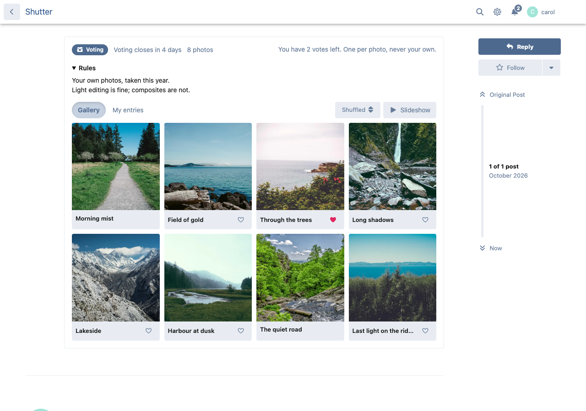
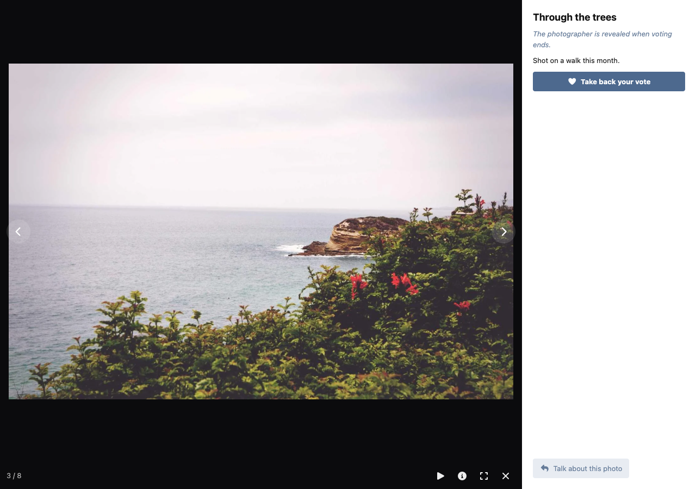
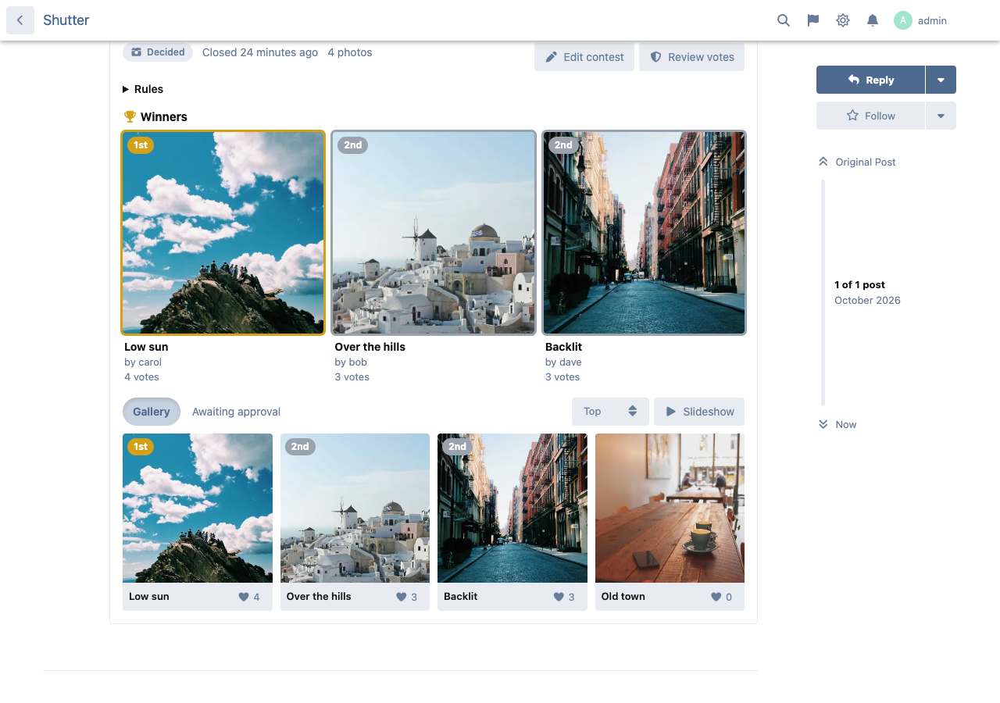
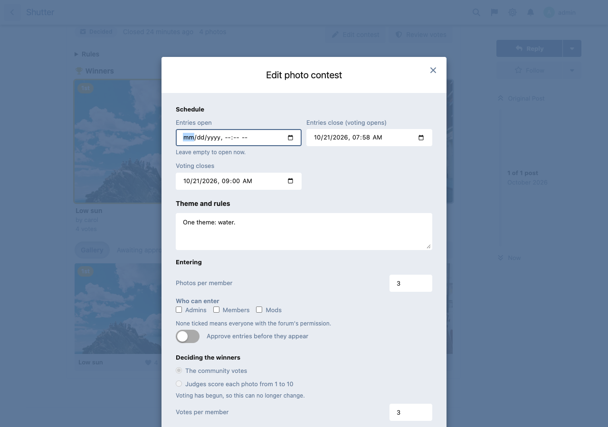
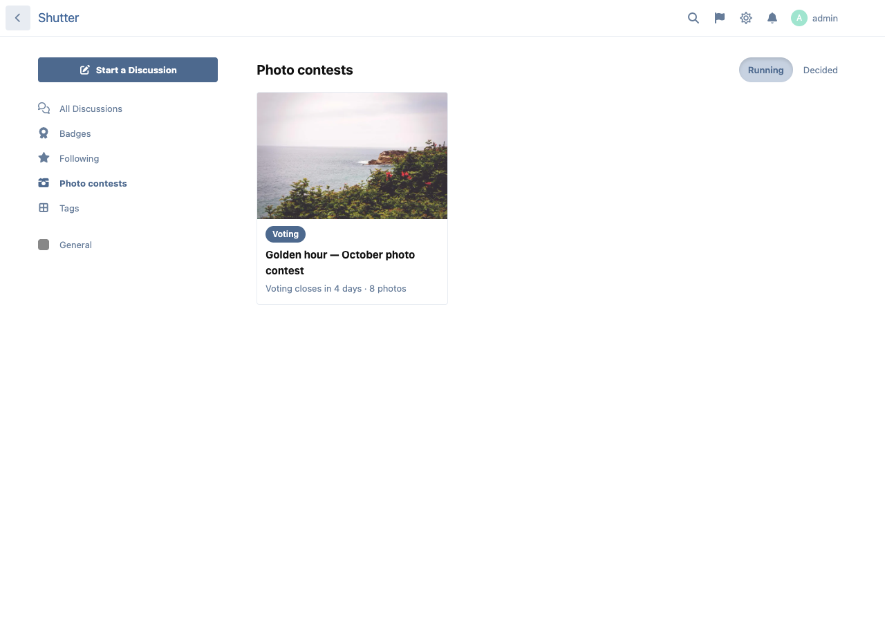
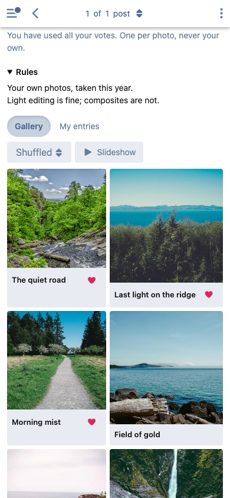

# Shutter — photo contests for Flarum


Run themed photo contests on your forum. Staff set the theme and the schedule, members enter their photos, the community votes (or your judges score), and the winners are crowned on a podium. A contest is a discussion, so the theme, the rules and the conversation around the entries all live in one place.



## Features

- **A contest is a discussion.** Start one from the composer ("Photo contest" button) or turn an existing discussion into one. The gallery sits under the first post. The contest is as visible as its discussion: tags, private discussions and hidden discussions are all respected.
- **Phases on a schedule:** opening soon, taking entries, voting, decided. Phases follow the clock, so they change on time whether or not your forum runs the scheduler.
- **Rules and eligibility:** photos per member, which groups may enter and which may vote, and a minimum account age and post count for voters. You can also choose to approve each entry before it appears.
- **Community voting or judges.**
  - Votes: a vote limit per member, one vote per photo, never your own.
  - Anonymous or named: named voters are shown only once voting closes.
  - Counts stay hidden until the end unless you turn on live counts.
  - Judged contests: named judges score each photo from 1 to 10, and the average decides.
- **Fair while it runs:** photographers' names can stay hidden until voting closes. Each voter sees the gallery in their own shuffled order, so no photo wins by being first in the grid.
- **Gallery, lightbox and slideshow:**
  - Square tiles over a blurred preview, so nothing pops in.
  - A full-size viewer with arrow keys, swipe, full screen and a slideshow.
  - Each photo shows its title, caption and the camera settings (camera, lens, shutter, aperture, ISO). "Talk about this photo" starts a reply that links to it.
- **Winners' podium** with gold, silver and bronze. Ties share a place.
  - Winners get an alert and an email; everyone else who entered hears that the results are in. Entrants also get an alert when voting opens.
  - Three [FoF Badges](https://github.com/FriendsOfFlarum/badges) triggers: contests won, podium finishes and photos entered.
- **Basic vote-ring detection** for staff. It flags:
  - votes from the photographer's own network;
  - many voters on one network;
  - accounts made during the contest;
  - entrants voting for each other.

  Staff void or restore votes with one click. Addresses are never stored, only a keyed hash of the network, and staff never see one.
- **Atrium galleries (optional).** With [Atrium](https://ernestdefoe.online) installed, a contest can name an album, and the podium photos are added to it when the contest is decided, credited to their photographers.
- **A contests page** (`/contests`) with running and decided contests.
- Translatable throughout, works in light and dark mode and on phones. It adds about 3 KB (gzipped) to the JavaScript every page loads; the gallery, viewer and editors load only where they are used.

## Screenshots

| A photo, full size | The winners |
| --- | --- |
|  |  |

| Running a contest | Every contest | On a phone |
| --- | --- | --- |
|  |  |  |

<sub>Photos in the screenshots are from [Unsplash](https://unsplash.com) via picsum.photos.</sub>

## Privacy and safety of uploads

- The type of each upload is read from its bytes. The filename and the type the browser declares are ignored.
- Only JPEG, PNG and WebP are accepted: no SVG, no GIF, nothing that can carry script.
- Every photo is decoded and saved again (WebP where the server supports it), so **what is served carries no metadata at all**. The original upload is never stored. Location data is never read into the database. On forums using the Imagick driver, metadata is stripped explicitly, because Imagick would otherwise keep it.
- There is a file size cap (set in the admin panel) and a 50-megapixel ceiling, checked before the photo is decoded. The stored copy is resized to the longest side you choose.
- Files are named by a hash of the upload, so no part of a path comes from the uploader.
- The same file cannot be entered twice in one contest.

## Installation

```sh
composer require ernestdefoe/shutter
```

Then enable **Shutter** in the admin panel.

## Updating

```sh
composer update ernestdefoe/shutter
php flarum migrate
php flarum cache:clear
```

## Permissions

| Permission | Default | What it allows |
| --- | --- | --- |
| Enter photo contests | Members | Submitting photos (a contest can narrow it to groups) |
| Vote in photo contests | Members | Voting (a contest can narrow it to groups) |
| Run photo contests | Moderators | Starting and editing contests, approving and disqualifying entries, reviewing votes |

## Scheduling

Contests change phase on time without anything running. To send "voting is open" alerts, and to decide a closed contest before anyone looks at it, run Flarum's scheduler (`php flarum schedule:run` every minute from cron). Shutter's own task, `php flarum shutter:tick`, runs every five minutes. Without the scheduler, a contest is decided the first time somebody opens it after voting closes.

## Settings

- **Show "Photo contests" in the sidebar** (once a contest exists).
- **Largest upload** in MB (1–50). PHP's `upload_max_filesize` and `post_max_size` must allow it too.
- **Longest side of the stored photo** (1024–4096 px, default 2560).

## Support

Questions and bug reports: [ernestdefoe.online](https://ernestdefoe.online).

☕ [Buy me a coffee](https://buymeacoffee.com/ernestdefoe)
